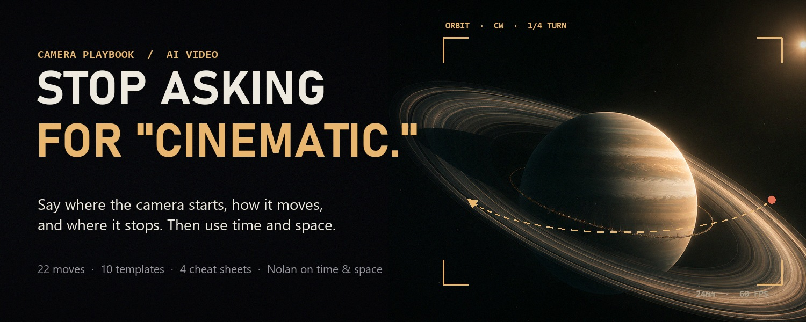
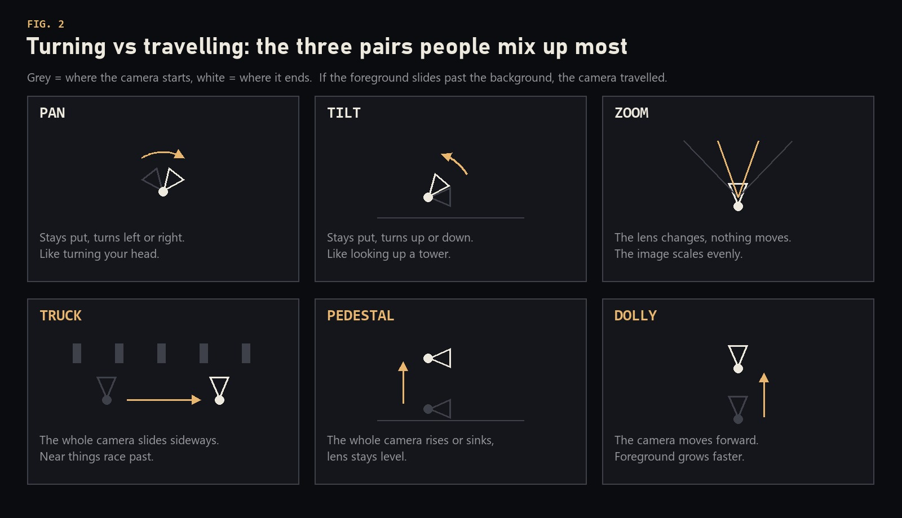
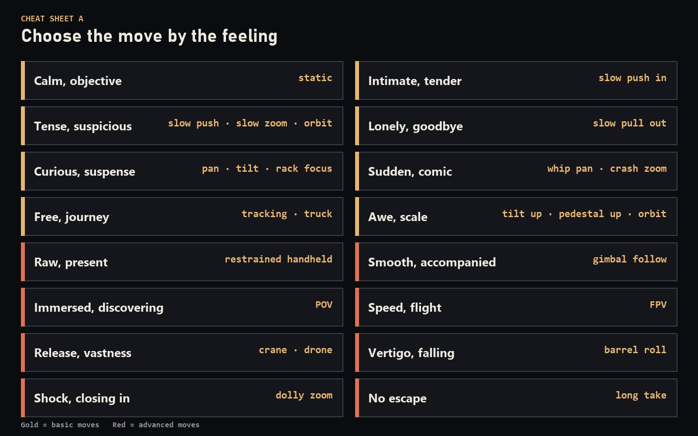
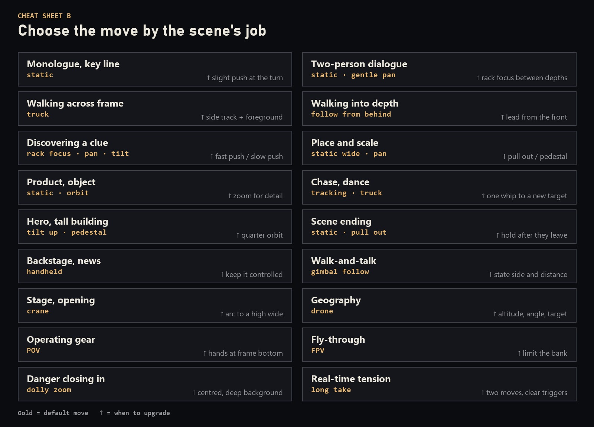
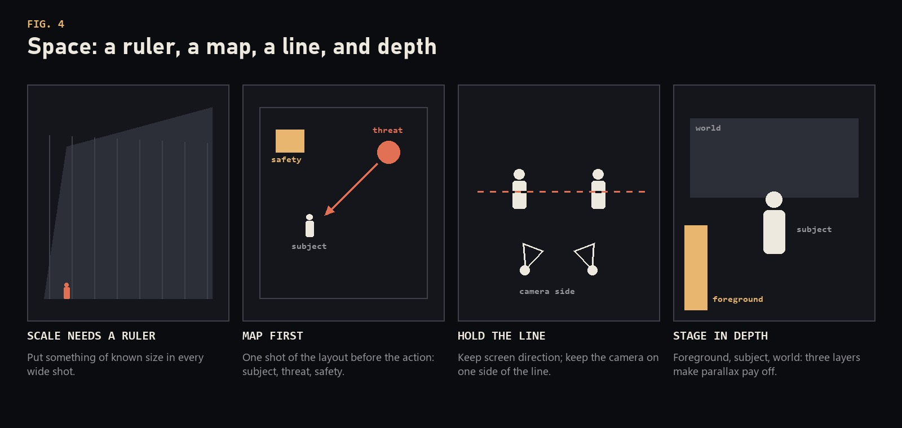
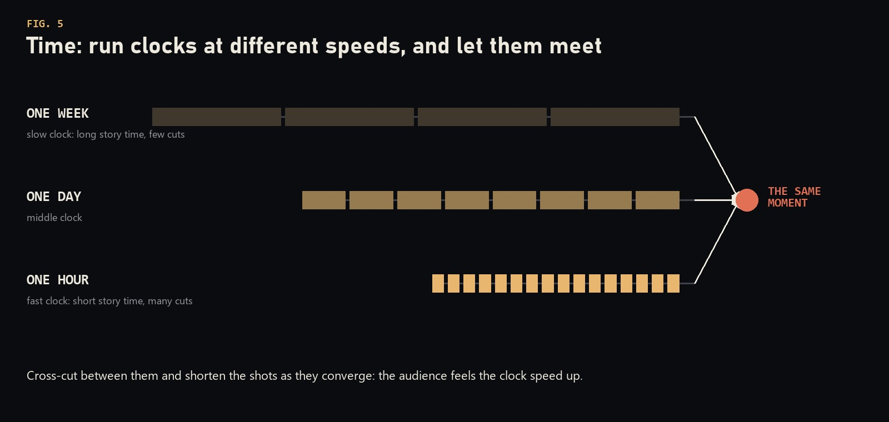
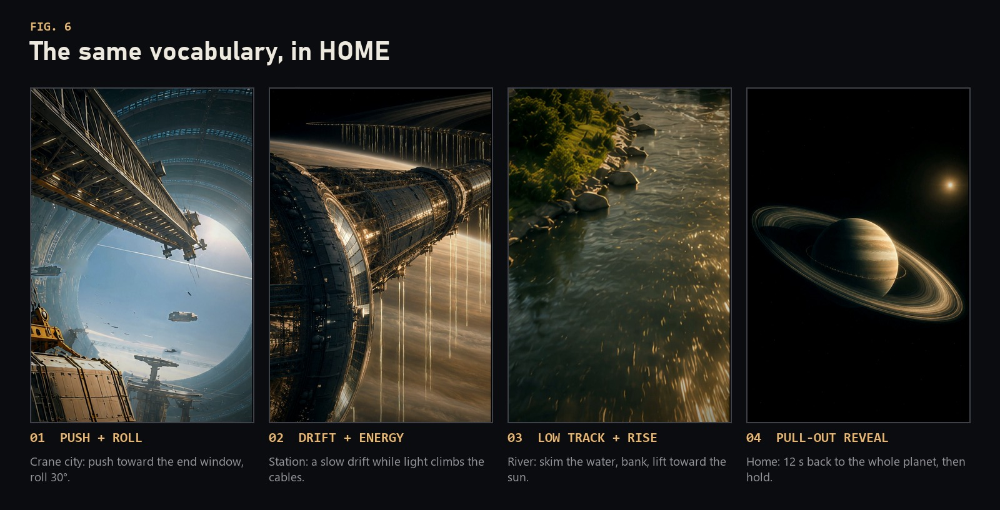

<p align="center">
  
</p>

<h1 align="center">cinematic-skills</h1>

<p align="center">
  <b>Agent skills that direct films, not just generate them.</b><br>
  Camera language, shot planning and a still-to-film pipeline for any AI agent.
</p>

<p align="center">
  <a href="LICENSE"></a>
  
  
  
</p>

<p align="center">
  <a href="README_zh.md">简体中文</a>
</p>

---

Ask a model for "something cinematic" and it guesses. Tell it where the camera starts, how it moves, where it stops and what must never change, and it executes.

These skills were built while making **HOME**, a two-minute vertical sci-fi short made with an AI coding agent, HyperFrames and Blender. The first version was a slideshow of zoomed stills. The final film took 11 animatics, 5 rough cuts, a depth-parallax renderer and a lot of precise notes. Everything that made the difference is packaged here so the next film starts where HOME ended.

## The skills

| Skill | What it does | Status |
|---|---|---|
| [**shot-director**](skills/shot-director/SKILL.md) | Plans, writes and reviews shots like a director. 22 camera moves with example prompts, 9 look-alike pairs, prompt templates, cheat sheets by feeling and by scene task, a failure checklist, and Nolan-style direction of time and space. Tool-agnostic: Sora, Veo, Kling, Runway, HyperFrames, Remotion, Blender or a real crew. | Stable |
| [**still-to-film**](skills/still-to-film/SKILL.md) | Turns still images into a film with real camera movement: 4x upscale, monocular depth, a WebGL depth-parallax camera with motion blur, motion inside the frame (sprites, water, energy), Blender CG inserts, film finishing and automated QA. | v0.1, evolving |

Use them together: **shot-director** decides what to shoot and why, **still-to-film** shoots it from stills.

## A look inside

<p align="center">
  
</p>

<p align="center">
  
  
</p>

<p align="center">
  
  
</p>

### Before and after

> Make it cinematic, with premium camera work.

> Eye-level medium shot, locked off to start. The engineer freezes when she hears footsteps behind her. The camera pushes in slowly from medium to a close-up of her face, steady speed, and stops the moment her eyes lift. She stays in place. No zoom, no orbit.

The second one is longer. It is also the only one a model can execute.

## Install

### Ask your agent

Paste this into Claude Code, Codex, Cursor or any agent that can run shell commands:

```text
Install the skills from https://github.com/AustinZ21/cinematic-skills
```

### Manual

macOS / Linux:

```bash
git clone https://github.com/AustinZ21/cinematic-skills.git
mkdir -p ~/.agents/skills
cp -r cinematic-skills/skills/* ~/.agents/skills/
```

Windows (PowerShell):

```powershell
git clone https://github.com/AustinZ21/cinematic-skills.git
New-Item -ItemType Directory -Force "$HOME\.agents\skills" | Out-Null
Copy-Item -Recurse cinematic-skills\skills\* "$HOME\.agents\skills\"
```

`~/.agents/skills` is the cross-agent location. If your agent does not discover skills there, copy the folders to its own skills directory instead, for example `~/.claude/skills` (Claude Code), `~/.codex/skills` (Codex) or `~/.cursor/skills` (Cursor). Install once, in one place.

To update, pull the repo and copy again.

## Works with any agent and any model

A skill here is just a folder with a `SKILL.md` (YAML front matter plus markdown), reference files and plain scripts. Nothing is tied to one vendor.

- **Agents with skill support** load `SKILL.md` automatically when a request matches its description, then open the reference files only when needed.
- **Agents without skill support** work too: point them at the file, or add one line to `AGENTS.md`, `CLAUDE.md` or your system prompt, such as *"Before planning any video, read `skills/shot-director/SKILL.md` and follow it."*
- **Any model** can use the content. The camera language is written as instructions a model can follow, and the scripts are ordinary Python, JavaScript and shell.

`still-to-film` additionally needs local tools to run its scripts: Python 3.10+, PyTorch and Transformers, OpenCV, FFmpeg, Node 18+ for HyperFrames, and optionally Blender and an NVIDIA GPU. See its [SKILL.md](skills/still-to-film/SKILL.md).

## Try it

```text
Plan a 60-second vertical teaser for a lunar mining colony, 120 BPM track.
Use shot-director: give me the clocks, the beats and a shot list.
```

```text
Here are three stills. Turn them into a 20-second film with real parallax
and one slow push into the window. Use still-to-film.
```

```text
Review this cut with shot-director. Notes as: shot, timestamp, move, direction,
start → end, speed, what stays still.
```

## Built for HOME

<p align="center">
  
</p>

HOME runs 2:03 at 60 fps in a 2:3 vertical frame, cut to a single music track at 125 BPM. It started from three images by [@martianprompts](https://x.com/martianprompts) and eight companion stills generated to complete the story; none of those source images are included in this repo. The frames above are from the finished film.

What HOME taught, now written into the skills:

- A still being zoomed reads as a slideshow. Real parallax and motion inside the frame read as a shot.
- Every move needs a start, an end and what stays fixed.
- The notes are the real prompt: shot, timestamp, what you see, what you want.
- Structure first: an animatic timed to the music, then one shot all the way to final, then production.
- The agent can check frames and numbers. A human checks feelings.

## Repository layout

```text
cinematic-skills/
├── skills/
│   ├── shot-director/
│   │   ├── SKILL.md
│   │   └── references/      foundations, moves, instructions, templates,
│   │                        cheat-sheets, time-and-space, review, depth-renderer
│   └── still-to-film/
│       ├── SKILL.md
│       ├── ROADMAP.md       what is not generalised yet
│       ├── references/      pipeline, depth renderer, pitfalls, finishing, Blender route
│       ├── scripts/         plate prep, masks, starfield, finish, QA
│       ├── assets/          depthshot.js (WebGL depth-parallax camera)
│       ├── templates/       a minimal HyperFrames depth shot
│       └── examples/        procedural Blender mothership
├── assets/                  cover and figures for this README
├── NOTICE.md                attributions
└── LICENSE                  MIT
```

## Roadmap

- **still-to-film:** generalise more of the HOME tooling (shot generator, mask builders, sprite cut-out), add more templates, and test on other films.
- **shot-director:** more worked examples per genre, and notes per video model as their camera control improves.

Issues and pull requests are welcome.

## Credits

- The move vocabulary, templates and cheat sheets in `shot-director` are adapted, rewritten in English with new examples, from Adrian Punk's two-part Chinese guide to AI video camera movement ([@AdrianPunk115](https://x.com/AdrianPunk115)). The time-and-space chapter, review format and depth-renderer mapping are original.
- Built on [HyperFrames](https://github.com/heygen-com/hyperframes), [GSAP](https://github.com/greensock/GSAP), [Depth Anything V2](https://github.com/DepthAnything/Depth-Anything-V2), [Swin2SR](https://github.com/mv-lab/swin2sr), [Transformers](https://github.com/huggingface/transformers), [OpenCV](https://github.com/opencv/opencv), [FFmpeg](https://github.com/FFmpeg/FFmpeg) and [Blender](https://github.com/blender/blender).
- See [NOTICE.md](NOTICE.md) for details.

## License

[MIT](LICENSE)
