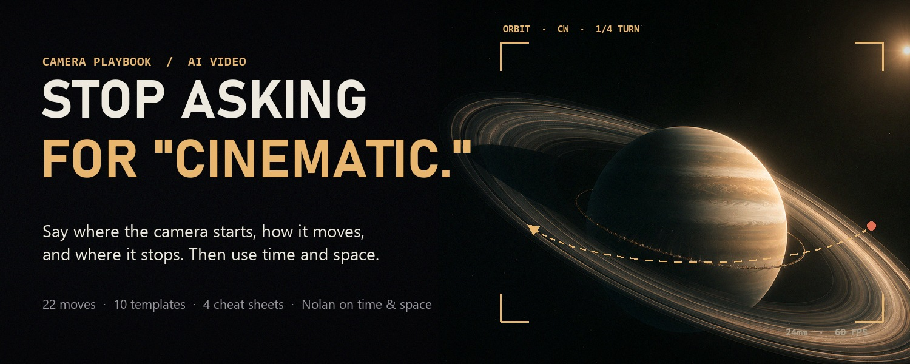
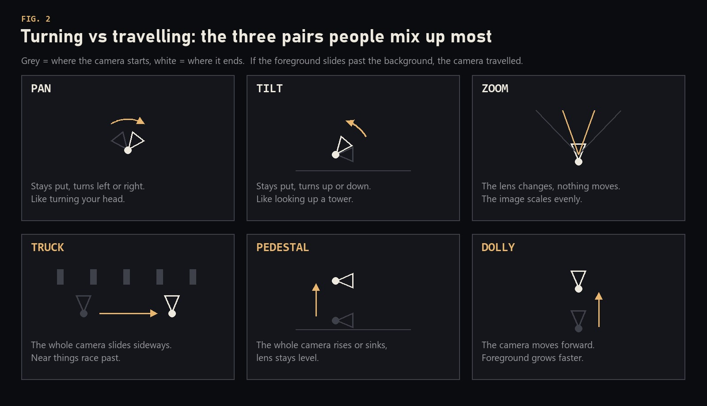
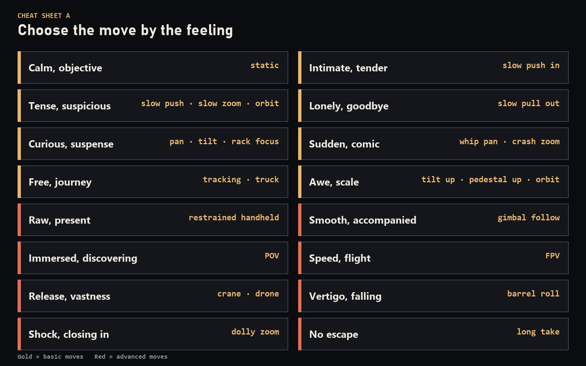
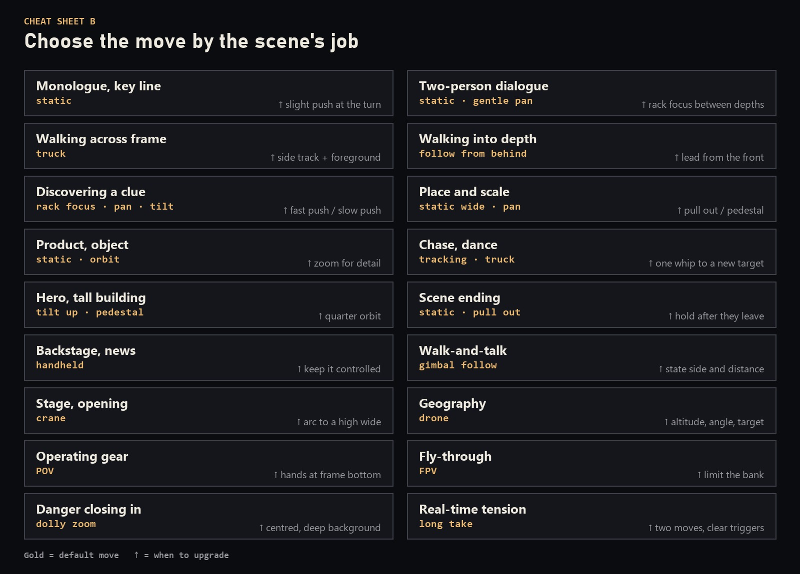
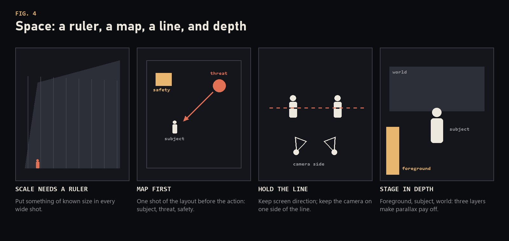
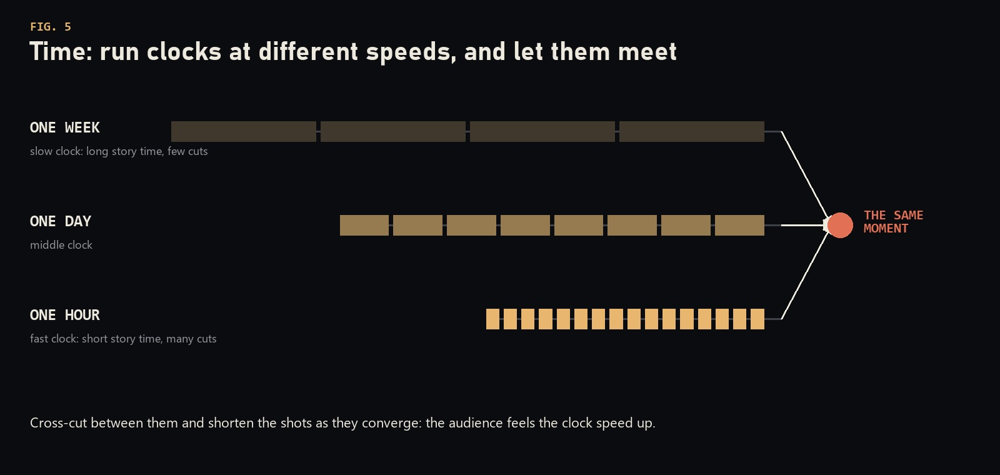
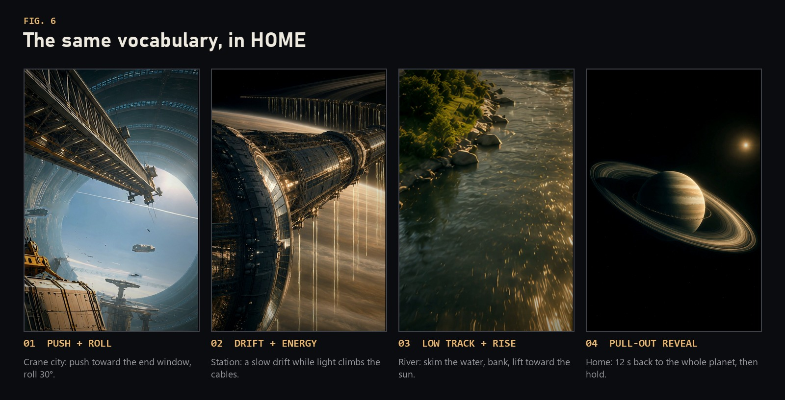

<p align="center">
  
</p>

<h1 align="center">cinematic-skills</h1>

<p align="center">
  <b>会当导演的 Agent Skill，而不只是会生成视频。</b><br>
  运镜语言、镜头规划，以及把静帧做成电影的完整流程，适用于任何 AI Agent。
</p>

<p align="center">
  <a href="LICENSE"></a>
  
  
  
</p>

<p align="center">
  <a href="README.md">English</a>
</p>

---

跟模型说"来点电影感"，它只能猜。告诉它镜头从哪开始、怎么动、停在哪、什么不能变，它才能执行。

这两个 Skill 来自 **HOME** 的制作过程。HOME 是一部两分钟的竖屏科幻短片，用 AI 编程 Agent、HyperFrames 和 Blender 完成。第一版只是一组被放大的静帧，像幻灯片；成片经历了 11 版动画样片、5 版粗剪、一个深度视差渲染器，以及大量精确的修改意见。真正起作用的东西都整理在这里，让下一部片子从 HOME 结束的地方开始。

## 两个 Skill

| Skill | 做什么 | 状态 |
|---|---|---|
| [**shot-director**](skills/shot-director/SKILL.md) | 像导演一样规划、写作和审阅镜头。22 个运镜及示范提示词、9 组易混运镜、提示词模板、按情绪和按场景任务的速查表、失败清单，以及诺兰式的时间与空间调度。不绑定工具：Sora、Veo、Kling、Runway、HyperFrames、Remotion、Blender，或者真实剧组都能用。 | 稳定 |
| [**still-to-film**](skills/still-to-film/SKILL.md) | 把静帧做成有真实运镜的电影：4 倍超分、单目深度估计、带运动模糊的 WebGL 深度视差相机、画面内部的运动（小飞船、水流、能量脉冲）、Blender CG 插入镜头、成片调色和自动质检。 | v0.1，持续完善 |

两个一起用：**shot-director** 决定拍什么、为什么拍，**still-to-film** 用静帧把它拍出来。

## 内容预览

<p align="center">
  
</p>

<p align="center">
  
  
</p>

<p align="center">
  
  
</p>

### 前后对比

> Make it cinematic, with premium camera work.

> Eye-level medium shot, locked off to start. The engineer freezes when she hears footsteps behind her. The camera pushes in slowly from medium to a close-up of her face, steady speed, and stops the moment her eyes lift. She stays in place. No zoom, no orbit.

第二段更长，但只有它是模型能执行的。

Skill 的内容是英文写的（方便任何模型和社区使用），用中文提需求完全没问题。

## 安装

### 让 Agent 帮你装

把这句话发给 Claude Code、Codex、Cursor 或任何能执行命令的 Agent：

```text
帮我安装 https://github.com/AustinZ21/cinematic-skills 里的 skills
```

### 手动安装

macOS / Linux：

```bash
git clone https://github.com/AustinZ21/cinematic-skills.git
mkdir -p ~/.agents/skills
cp -r cinematic-skills/skills/* ~/.agents/skills/
```

Windows（PowerShell）：

```powershell
git clone https://github.com/AustinZ21/cinematic-skills.git
New-Item -ItemType Directory -Force "$HOME\.agents\skills" | Out-Null
Copy-Item -Recurse cinematic-skills\skills\* "$HOME\.agents\skills\"
```

`~/.agents/skills` 是跨 Agent 的通用目录。如果你的 Agent 在那里找不到 Skill，再复制到它自己的目录，例如 `~/.claude/skills`（Claude Code）、`~/.codex/skills`（Codex）、`~/.cursor/skills`（Cursor）。装一次、装一个地方就够了。

更新时拉取仓库，再复制一次。

## 任何 Agent、任何模型都能用

这里的每个 Skill 就是一个文件夹：一个 `SKILL.md`（YAML 头信息加 Markdown）、若干参考文件和普通脚本，不绑定任何厂商。

- **支持 Skill 的 Agent**：请求匹配描述时自动加载 `SKILL.md`，需要时才打开参考文件。
- **不支持 Skill 的 Agent**：也能用。直接让它读这个文件，或在 `AGENTS.md`、`CLAUDE.md`、系统提示里加一句："规划任何视频之前，先读 `skills/shot-director/SKILL.md` 并照做。"
- **任何模型**：运镜语言写成了模型能照做的指令，脚本是普通的 Python、JavaScript 和 Shell。

`still-to-film` 运行脚本还需要本地工具：Python 3.10+、PyTorch 和 Transformers、OpenCV、FFmpeg、Node 18+（HyperFrames），可选 Blender 和 NVIDIA 显卡。详见它的 [SKILL.md](skills/still-to-film/SKILL.md)。

## 试一试

```text
给一个月球采矿殖民地做 60 秒竖屏预告，配乐 120 BPM。
用 shot-director：先给我三个时钟、节拍结构和镜头表。
```

```text
这是三张静帧，做成 20 秒的短片，要有真实视差，
最后一个镜头缓慢推进窗户。用 still-to-film。
```

```text
用 shot-director 审这一版。意见格式：镜头、时间点、运镜、方向、
起点 → 终点、速度、什么保持不动。
```

## 来自 HOME

<p align="center">
  
</p>

HOME 时长 2:03，60 fps，2:3 竖屏，配一首 125 BPM 的音乐。它从 [@martianprompts](https://x.com/martianprompts) 的三张图出发，另外生成了八张配套静帧来补全故事；这些源图都没有放进本仓库。上图是成片截帧。

HOME 教会我们的，已经写进 Skill：

- 被放大的静帧看起来像幻灯片；真实视差加上画面内部的运动，才像一个镜头。
- 每个运镜都要有起点、终点和保持不变的东西。
- 修改意见才是真正的提示词：镜头、时间点、看到什么、想要什么。
- 先搭结构：按音乐卡好的动画样片，再把一个镜头做到成片，最后才全面制作。
- Agent 能检查画面和数字，人负责检查感觉。

## 仓库结构

```text
cinematic-skills/
├── skills/
│   ├── shot-director/
│   │   ├── SKILL.md
│   │   └── references/      基础、运镜、指令写法、模板、速查表、
│   │                        时间与空间、审阅清单、深度渲染器映射
│   └── still-to-film/
│       ├── SKILL.md
│       ├── ROADMAP.md       尚未通用化的部分
│       ├── references/      流程、深度渲染器、踩坑记录、成片收尾
│       ├── scripts/         素材准备、遮罩、星空、收尾、质检
│       ├── assets/          depthshot.js（WebGL 深度视差相机）
│       ├── templates/       最小可运行的 HyperFrames 深度镜头
│       └── examples/        程序化 Blender 母舰
├── assets/                  README 用的封面和配图
├── NOTICE.md                署名与致谢
└── LICENSE                  MIT
```

## 路线图

- **still-to-film**：把 HOME 的更多工具通用化（镜头生成器、遮罩构建、精灵抠图），增加模板，在更多片子上验证。
- **shot-director**：按类型补充更多示例，随着各视频模型运镜控制能力的提升，补充针对模型的写法。

欢迎提 Issue 和 PR。

## 致谢

- `shot-director` 中的运镜词汇、模板和速查表，改编自 Adrian Punk 的两篇中文 AI 视频运镜指南（[@AdrianPunk115](https://x.com/AdrianPunk115)），用英文重写并更换了示例。时间与空间一章、审阅格式和深度渲染器映射为原创。
- 基于 [HyperFrames](https://github.com/heygen-com/hyperframes)、[GSAP](https://github.com/greensock/GSAP)、[Depth Anything V2](https://github.com/DepthAnything/Depth-Anything-V2)、[Swin2SR](https://github.com/mv-lab/swin2sr)、[Transformers](https://github.com/huggingface/transformers)、[OpenCV](https://github.com/opencv/opencv)、[FFmpeg](https://github.com/FFmpeg/FFmpeg) 和 [Blender](https://github.com/blender/blender)。
- 详见 [NOTICE.md](NOTICE.md)。

## 许可证

[MIT](LICENSE)
